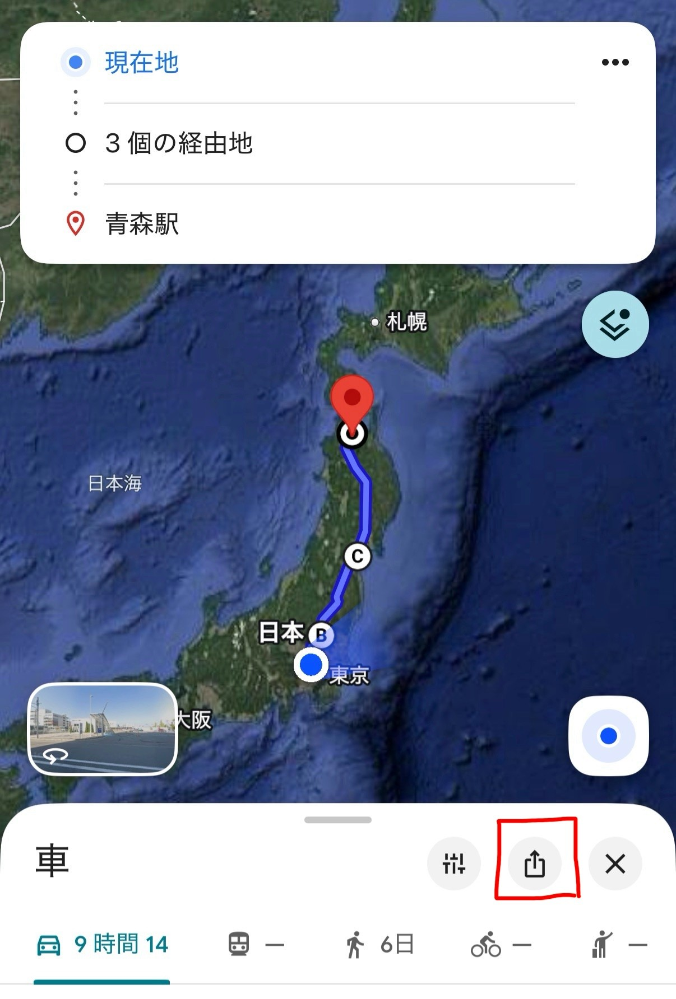
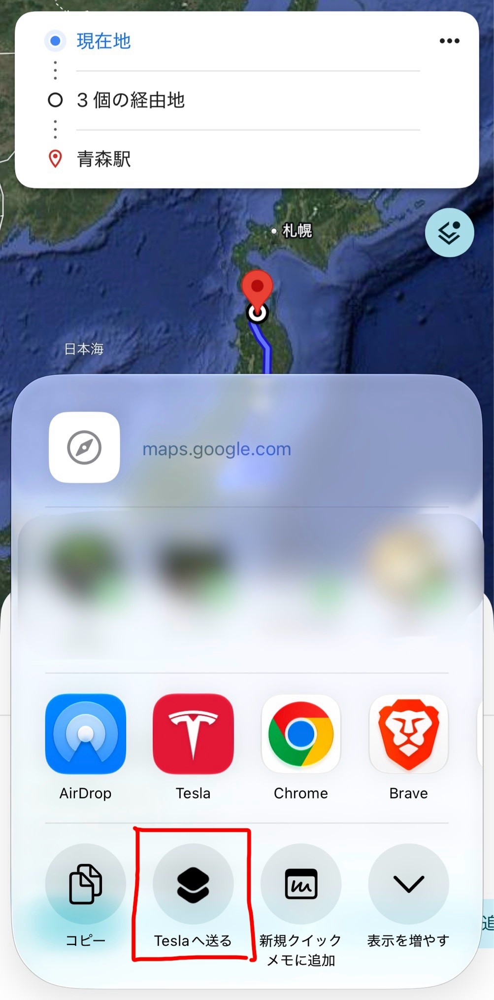
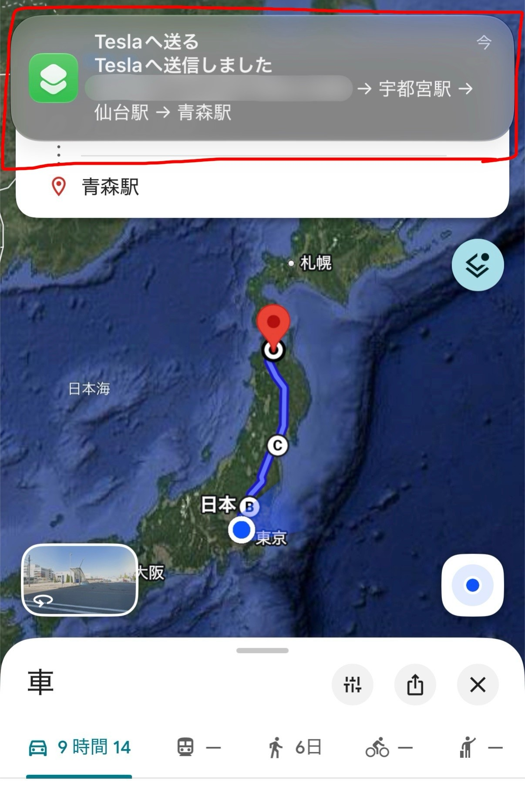
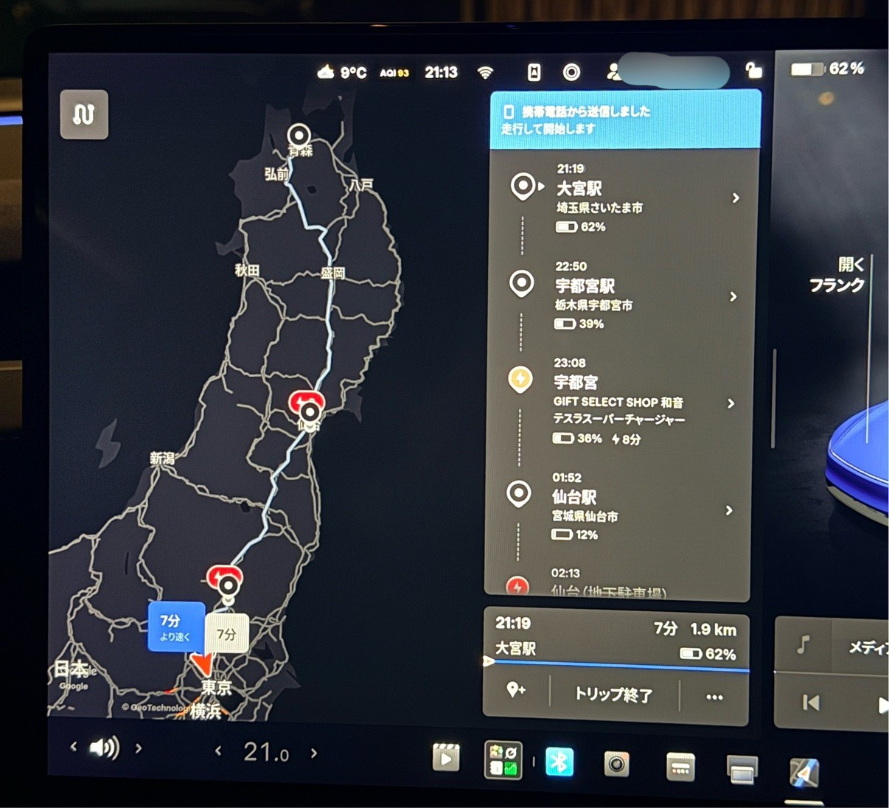
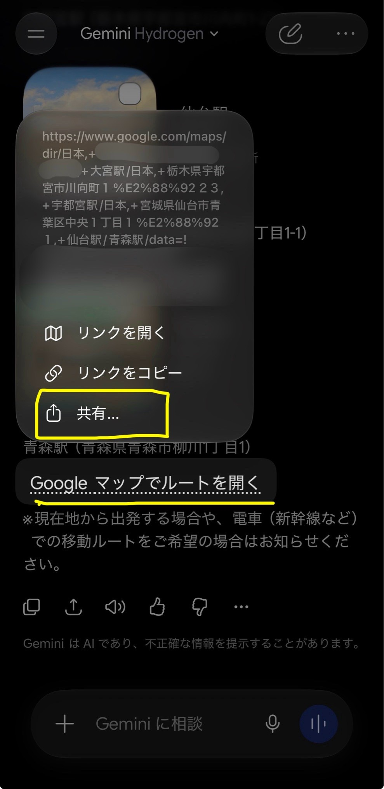

# Maps2Tesla

Google Maps で作った複数経由地ルートを、そのまま Tesla のナビに送るツールです。

- Google Maps の共有リンク → 経由地を取り出し → 車に一括送信
- 名前だけのリンクや座標だけの地点も、場所を解決してから送ります
  （解決できない地点は勝手に置き換えず、結果に明記します）
- 自宅の PC / NAS / Raspberry Pi などで Docker コンテナとして動かします
- 鍵やトークンは自分の手元（コンテナの data フォルダ）にだけ保存され、
  外部のサーバーには送られません

## 利用イメージ

Google Maps で経由地つきルートを作り、共有から送るだけです。

 

送信が完了すると通知が出ます。

車のナビでは、車側のTrip Plannerが動作します。

Gemini等AIが出力した旅行プランのルートリンクからも送れます。

## 必要なもの

- Docker が動く場所
- Tesla アカウント（車のオーナーアカウント）
- Tesla 開発者登録（手順書に沿ってフォーム入力するだけです）
- GitHub アカウント（公開鍵の置き場所として GitHub Pages を使います。無料）
- Tailscale などの VPN (外出先からも使う場合)

## 導入

手順は [docs/SETUP.md](docs/SETUP.md) に、1 ステップずつ書いてあります。
コンテナを起動したら、ブラウザで `/setup` を開くと設定ウィザードが
出るので、画面の順に進めるだけです。

iPhone の共有から送るショートカットは、作成済みのものを
配布しています（[共有リンク](https://www.icloud.com/shortcuts/677d1306d8d8433aaf842fb2710872b9)、
詳しくは SETUP.md のステップ 7（任意））。

## 使い方（導入後）

1. Google Maps でルートを作る（経由地も追加）
2. 共有 → iPhone ショートカット「Teslaへ送る」（または PC で Web 画面にリンクを貼る）

詳しくは [docs/USAGE.md](docs/USAGE.md) をご覧ください。

## 制限

- 経由地は Google の「場所」として認識された地点のみ対応します
  (Google Mapsで検索して出てくる場所なら使えるはずです)
- 座標だけの地点かつ100m以内に登録済みの場所が無い場合、
  安全のため送信から外し、通知に表示します。
  （自宅のように場所として登録されていない地点の座標は外れます）
- 経路と充電計画は車側で再計算されます
- Tesla Fleet API の利用には、ご自身の開発者アカウントでの従量課金が
  発生します。ただし、毎月 $10 分の無料クレジットがあり、車の起床
  （wake_up）は 1 回 $0.02 なので、起床だけなら月に約 500 回まで
  無料枠に収まります。送信 1 回にかかるのは起床とわずかなコマンド料
  だけなので、通常の使い方では費用はかからないと考えて大丈夫です。
  なお、Tesla 側の起床の制限は 1 分に 3 回までで、本アプリは
  1 分に 2 回までに抑え、制限に当たったら自動で待つ
  作りになっています。
- 検証は行おりますが個人開発のため限界があります。
  不具合(目的地漏れ、外れ、Tesla Fleet APIの異常使用等)があるケースも想定し
  ご自身で追加検証、ご利用いただきますようお願いいたします。    

## ライセンス

MIT License — 詳細は [LICENSE](LICENSE) をご覧ください。
